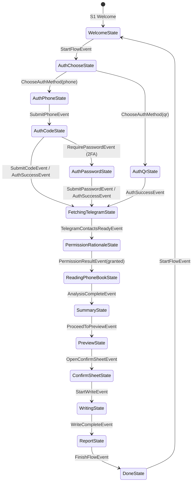

# TelSync (تلسینک) — Comprehensive Agent & Developer Handbook

> **Brand Name:** تلسینک (TelSync)  
> **Subtitle:** انتقال امن و مستقیم مخاطبین تلگرام به گوشی  
> **Document Version:** 2.0  
> **Last Updated:** November 2026  
> **Target Audience:** AI Agents (Antigravity, Gemini, Claude, GPT), Core Contributors, and Technical Maintainers.

---

## 1. Executive Summary & Core Mission

**TelSync (تلسینک)** (formerly Contact Bridge) is an offline-first, zero-backend mobile application built with **Flutter & Dart** that allows users to export and synchronize contacts from their **Telegram** account directly into their phone’s native address book.

### 1.1 The Core Problem Solved
Millions of users have hundreds of contacts stored in Telegram chats and mutual lists whose phone numbers are **not** saved on their physical mobile device (e.g. after switching phones, losing SIM cards, or saving contacts exclusively inside Telegram).

### 1.2 Non-Negotiable Architectural Invariants (The Constitution)
All future AI agents and contributors **MUST** respect these 11 architectural invariants:

1. **INV-01 (100% On-Device Processing):** All contact normalization, matching, analysis, and writing happens exclusively on the user’s physical device.
2. **INV-02 (Zero Developer Backend):** The developer operates zero servers, databases, or cloud endpoints. No contact, phone number, session key, or telemetry ever leaves the device to any third-party or developer server.
3. **INV-03 (No Internal User Account):** There is no registration, login, or user profile system for this app.
4. **INV-04 (Read-Only Safety Guarantee):** Existing phone contacts are **NEVER** modified, edited, reordered, merged, or deleted.
5. **INV-04a (Ephemeral Undo):** The Undo action only deletes contacts that were newly written during the *current active session* (held in volatile RAM). Once the session ends, existing contacts remain untouched.
6. **INV-05 (Additive Only):** Only missing, valid phone numbers from Telegram are inserted as new phonebook entries.
7. **INV-06 (Explicit Preview & Consent):** The user **MUST** be presented with a full, categorized preview of candidates with the ability to select/deselect and edit names before any write operation is committed.
8. **INV-07 (Core Features Free):** The core synchronization capability is accessible without paywalls.
9. **INV-08 (Ad Isolation):** Any future advertising SDKs (e.g. Tapsell, Yektanet) must run in isolated boundaries (`packages/ads_noop`) with zero permission or memory access to contact data.
10. **INV-09 (Zero Analytics/Trackers in Core):** No Firebase Analytics, Crashlytics, or telemetry SDKs that read device state.
11. **INV-10 (Strict Telegram API Allowlist):** Only an explicit, audited allowlist of TDLib C++ methods may be dispatched to the Telegram network.
12. **INV-11 (Ephemeral Session Termination):** Telegram sessions are strictly ephemeral. Whenever the user finishes, cancels, backs out, or closes the app, a full server-side `logOut()` is dispatched to Telegram servers and local temporary SQLite files are securely wiped so no active session remains in Telegram’s "Active Sessions" list.

---

## 2. Technology Stack & Environment

| Component | Technology / Library | Version / Details |
| :--- | :--- | :--- |
| **Framework** | Flutter | `>=3.0.0 <4.0.0` (Dart 3 with sealed classes & pattern matching) |
| **State Management** | `flutter_riverpod` | `^3.4.3` (`Notifier<FlowState>`) |
| **Telegram Core** | **TDLib (Telegram Database Library)** | C++ Shared Library (`libtdjson.so`) via Dart FFI |
| **Concurrency Bridge** | Background Dart Isolate | Independent event-loop polling `td_json_client` |
| **Native IPC** | Flutter Pigeon | Type-safe code generation for Android `ContactsContract` |
| **Normalization** | Pure Dart Phone Engine | E.164 parsing, Persian/Arabic digit conversion (`۰-۹` -> `0-9`) |
| **UI Design System** | Material 3 + Custom Tokens | High contrast, full RTL, Persian typography (`Vazirmatn`) |
| **Localization** | `packages/l10n` | Persian (`fa`) & English (`en`) |
| **Build Optimization**| R8/ProGuard + ABI Splits | `arm64-v8a` release APK size: **~49 MB** |

---

## 3. Monorepo Structure & Package Responsibilities

The codebase follows a modular Monorepo layout. All business logic is decoupled into pure-Dart packages with zero Flutter dependencies where possible:

```
tel/
├── apps/
│   └── mobile/                       # The main Flutter Application
│       ├── android/                  # Android native project & ProGuard rules
│       ├── lib/
│       │   ├── config/               # Telegram API keys & app configurations
│       │   ├── controllers/          # Riverpod ImportFlowController & providers
│       │   ├── services/             # Live network location & VPN detection
│       │   ├── views/                # Views S1 through S18 & dialogs
│       │   └── main.dart             # Application entrypoint
│       └── test/                     # Controller, widget, and lifecycle tests
├── packages/
│   ├── core_domain/                  # Pure Dart: State machine, entities, events, reducer
│   ├── core_phone/                   # Pure Dart: Phone number normalization & E.164
│   ├── match_engine/                 # Pure Dart: Matching algorithm, 4 reporting identities
│   ├── source_telegram/              # Dart FFI: TDLib C-client, Isolate bridge, allowlist
│   ├── sink_phonebook/               # Pigeon IPC: Android ContactsContract reader/writer
│   ├── platform_security/            # In-memory encryption key generator & session cleaner
│   ├── design_system/                # Design tokens, AppScaffold, OtpField, PasswordField
│   ├── l10n/                         # Bilingual localization strings (FA / EN)
│   └── ads_noop/                     # No-op ad abstraction enforcing data isolation
├── tools/                            # Developer utilities & test scripts
│   ├── run_env.ps1                   # Environment wrapper ensuring correct Flutter/Java PATH
│   ├── check_allowlist.dart          # CI script validating TDLib method allowlist
│   └── check_deps.dart               # Dependency validator ensuring no forbidden packages
└── docs/                             # Architecture specifications & agent documentation
```

### Key Package Breakdown:

#### 1. `packages/core_domain`
- Contains the pure-Dart state machine: `reduce(FlowState state, FlowEvent event) -> FlowState`.
- Implements sealed class hierarchies for states (`FlowState`) and events (`FlowEvent`).
- Pure entities: `SourceContact`, `ImportCandidate`, `ReportCounters`, `NormalizedNumber`.
- Mathematical guarantee: 4 identity equations verified via unit tests for report counters.

#### 2. `packages/source_telegram`
- Connects directly to Telegram via **TDLib** (C++ native library).
- Uses `TelegramIsolateBridge`: Spawns a dedicated background Dart Isolate that runs a 20ms polling loop on `TdJsonClient.receive()`, completely offloading JSON parsing from the UI isolate.
- `TdRequestFactory`: Enforces **INV-10** (strict allowlist). Any method not explicitly allowed throws an assertion error.
- Handles Auth states: QR login, Phone number submission, 5-digit OTP code, and **Two-Factor Authentication (2FA) Cloud Password** (`authorizationStateWaitPassword`).

#### 3. `packages/sink_phonebook`
- Reads native Android contacts via Pigeon.
- Writes newly confirmed contacts in batched transactions to Android `ContactsContract.RawContacts` and `Data`.
- Tracks newly written IDs in memory for the ephemeral single-session Undo capability (**INV-04a**).

#### 4. `apps/mobile/lib/services/network_location_service.dart`
- Multi-source geolocation resolver without external packages (using `dart:io` native `HttpClient`).
- Queries `https://api.country.is`, `https://cloudflare.com/cdn-cgi/trace`, and `http://ip-api.com/json`.
- Detects if the user's IP is in Iran (`IR`) or blocked regions where Telegram is censored.

---

## 4. State Machine & Application Flow (S1 through S18)

The application flow is represented as a finite state machine managed by `FlowReducer` and orchestrated by `ImportFlowController`.



### Complete Screen-to-State Mapping:

| Screen Code | Class Name | State Class | Description & Key Responsibilities |
| :--- | :--- | :--- | :--- |
| **S1** | `S1WelcomeView` | `WelcomeState` | Clean landing page, prominent Start Card, privacy badges. Checks VPN before proceeding. |
| **S2** | `S2AuthChooseView` | `AuthChooseState` | Option selection: Phone & Code (Recommended for current device) vs QR Code. |
| **S3** | `S3AuthPhoneView` | `AuthPhoneState` | Phone number entry with `+98` prefix, Persian digit normalizer, and in-body submit button. |
| **S4** | `S4AuthCodeView` | `AuthCodeState` | 5-digit obscured OTP entry with auto-submit on 5th digit. |
| **S5** | `S5AuthPasswordView` | `AuthPasswordState`| **2FA Cloud Password:** Displays hint from Telegram, obscured password field, validates `PASSWORD_HASH_INVALID`. |
| **S6** | `S6AuthQrView` | `AuthQrState` | Renders dynamic QR code with countdown timer for 2nd-device login. |
| **S7** | `S7FetchingView` | `FetchingTelegramState`| Progress bar showing live contact extraction from Telegram cloud. |
| **S8** | `S8PermissionView` | `PermissionRationaleState`| Explains why contact permission is needed before triggering OS dialog. |
| **S9** | `S9AnalyzingView` | `ReadingPhoneBookState` / `AnalyzingState` | On-device deduplication and match engine comparison. |
| **S10** | `S10SummaryView` | `SummaryState` | Stat cards showing total found, new unique contacts, and skipped duplicates. |
| **S11** | `S11PreviewView` | `PreviewState` | Full interactive list: categorized tabs, name editing, manual select/deselect. |
| **S12** | `S12ConfirmSheet` | `ConfirmSheetState` | Modal bottom sheet requesting final user confirmation before writing to disk. |
| **S13** | `S13WritingView` | `WritingState` | Batch writing progress bar inserting to native address book. |
| **S14** | `S14ReportView` | `ReportState` | Success report with single-tap **Undo** button. |
| **S15** | `S15SettingsSheet` | *Modal Sheet* | Default country code configuration, cache info, and session reset. |
| **S16** | `S16AboutSheet` | *Modal Sheet* | Transparency, privacy statement, and open-source acknowledgments. |
| **S17** | `S17RecoveryView` | `RecoveryCleanupState` / `CleanupState` | Clean wipe and recovery after an unexpected error or cancellation. |
| **S18** | `S18ErrorView` | *Dialog / SnackBar* | Network timeout, flood wait, or TDLib failure feedback. |

---

## 5. Telegram Integration (TDLib & Source Telegram)

### 5.1 TDLib Architecture
The app bundles precompiled C++ binaries (`libtdjson.so`) inside `apps/mobile/android/app/src/main/jniLibs/` for `arm64-v8a`, `armeabi-v7a`, and `x86_64`.

```
Dart UI Isolate
     │
     ▼ (Riverpod Dispatches)
ImportFlowController
     │
     ▼ (Sends Requests / Listens to Updates)
TdlibAuthSession
     │
     ▼ (Bidirectional SendPort / ReceivePort)
TelegramIsolateBridge (Dedicated Dart Isolate)
     │
     ▼ (Dart FFI)
TdJsonClient (libtdjson.so)
     │
     ▼ (MTProto over TCP)
Telegram Cloud Servers
```

### 5.2 Strict Method Allowlist (**INV-10**)
Only the following methods are permitted in `packages/source_telegram/lib/td_request_factory.dart`:
```dart
const allowableMethods = <String>{
  'setTdlibParameters',
  'checkDatabaseEncryptionKey',
  'setAuthenticationPhoneNumber',
  'checkAuthenticationCode',
  'checkAuthenticationPassword', // 2FA Cloud Password
  'requestQrCodeAuthentication',
  'getContacts',
  'getUser',
  'logOut',
  'close',
  'destroy',
};
```
Any call attempting to read chats, messages, media, or private channels will immediately fail in unit tests (`allowlist_test.dart`).

### 5.3 Two-Factor Authentication (2FA) Implementation
1. When user enters OTP code, TDLib may emit `authorizationStateWaitPassword`.
2. `TdlibAuthSession` captures `password_hint` from the update payload.
3. `ImportFlowController` dispatches `RequirePasswordEvent(hint: session.passwordHint)`.
4. `FlowReducer` transitions state to `AuthPasswordState`.
5. `S5AuthPasswordView` displays the password field and hint banner.
6. User enters cloud password -> `controller.submitPassword(pwd)` invokes `checkAuthenticationPassword`.
7. On invalid password (`PASSWORD_HASH_INVALID`), user is notified without wiping state.
8. On success, TDLib emits `authorizationStateReady`, transitioning to `FetchingTelegramState`.

### 5.4 Ephemeral Session & Automatic Logout (**INV-11**)
To guarantee zero lingering sessions:
1. `logOutAndCleanSession()` dispatches `logOut` to TDLib, closes the isolate bridge, and deletes temporary database directories.
2. In `FlowScreenHost`, `WidgetsBindingObserver` monitors `AppLifecycleState.detached`: if the app is killed or swiped away from Recents, cleanup runs immediately.
3. Double-back exit on the Welcome screen or confirming exit on sensitive screens automatically triggers `logOutAndCleanSession()`.

---

## 6. Iran & VPN Censorship Guardian (`VpnGuardianDialog`)

Because Telegram is filtered in Iran, TDLib cannot connect without a VPN. Attempting to connect directly leads to infinite socket timeouts or flood-waits.

### Implementation:
- **Service:** `apps/mobile/lib/services/network_location_service.dart` checks public IP country via `api.country.is` and `cloudflare.com/cdn-cgi/trace`.
- **Dialog:** `apps/mobile/lib/views/vpn_guardian_dialog.dart` displays an animated warning dialog if country code is `IR`.
- **Behavior:**
  - Auto-polls every **20 seconds**.
  - Provides a **"بررسی مجدد" (Check Now)** button for instant verification.
  - As soon as the user enables their VPN (country changes to `DE`, `US`, `TR`, etc.), the dialog turns green with a checkmark and automatically dismisses after 800ms, resuming the flow seamlessly.
  - The bypass button was removed per product requirements to ensure users never get stuck in broken connection states.

---

## 7. UX & Keyboard Handling Rules

### The Keyboard Occlusion Bug & Fix
In Flutter, `Scaffold.bottomNavigationBar` is docked at the physical bottom and does **NOT** float above the soft keyboard when `resizeToAvoidBottomInset: true` is enabled.

**Design Rule for Input Screens (S3 Phone, S4 Code, S5 Password):**
- Primary action buttons (`PrimaryButton`) are placed **directly inside the scrollable column** beneath the input fields, **NOT** in `bottomNavigationBar`.
- In `AppScaffold`, any optional `bottomNavigationBar` is wrapped with `Padding(padding: EdgeInsets.only(bottom: MediaQuery.of(context).viewInsets.bottom))`.
- In `S3AuthPhoneView`: keyboard has `textInputAction: TextInputAction.done`.
- In `S4AuthCodeView`: `OtpField` triggers auto-submit immediately upon entering the 5th digit.

---

## 8. Developer & Agent Operational Guide

### 8.1 Environment Wrapper
Always execute Flutter and Dart commands through `tools/run_env.ps1` to ensure correct Android SDK and Java 17 PATHs:
```powershell
powershell -ExecutionPolicy Bypass -File tools/run_env.ps1 "cd apps/mobile; flutter analyze; flutter test"
```

### 8.2 Building Release APKs (Optimized for Storage)
Do **NOT** run generic `flutter build apk` (which bundles all 3 ABIs into an unmanageable ~285 MB file). Always use `--split-per-abi`:
```powershell
powershell -ExecutionPolicy Bypass -File tools/run_env.ps1 "cd apps/mobile; flutter build apk --release --split-per-abi"
```
**Output Artifacts (`apps/mobile/build/app/outputs/flutter-apk/`):**
- `app-arm64-v8a-release.apk` (~49.0 MB) — Primary target for modern Android devices (e.g. POCO X3, Galaxy, Pixel).
- `app-armeabi-v7a-release.apk` (~36.0 MB) — Legacy 32-bit devices.
- `app-x86_64-release.apk` (~49.8 MB) — Emulators and Chromebooks.

### 8.3 Direct ADB Deployment
```powershell
powershell -ExecutionPolicy Bypass -File tools/run_env.ps1 "adb install -r C:\Users\AyzaPc\Desktop\ContactBridge.apk"
powershell -ExecutionPolicy Bypass -File tools/run_env.ps1 "adb shell am start -n com.contactbridge.mobile/.MainActivity"
```

---

## 9. Visual Identity, Store Listings & Commercialization Kit

### 9.1 Visual Identity & Design System Tokens
- **Brand Name:** تلسینک (TelSync)
- **Logo Symbolism:** White paper airplane wing (Telegram) transitioning via a circular sync arrow to an emerald contact silhouette, representing direct and secure contact synchronization.
- **Color Palette:**
  - **Primary Brand (Telegram Sky Blue - `#229ED9`):** Primary buttons (`PrimaryButton`), progress indicators in `S7FetchingView`, accent links.
  - **Background & High Contrast (Deep Navy - `#0F172A`):** Dark theme background, card containers, high cybersecurity and data protection aesthetic.
  - **Trust & Success (Emerald Green - `#10B981`):** Privacy badges on `S1WelcomeView`, VPN verification in `VpnGuardianDialog`, success screen (`S14ReportView`).
  - **Warning & Error (Amber `#F59E0B` & Coral Red `#EF4444`):** Amber for permission explanations (`S8PermissionView`) and Iran IP detection; Red for 2FA password errors (`PASSWORD_HASH_INVALID`) and timeouts.
- **Typography:** Persian **Vazirmatn** font with full RTL layout and English fallback in `packages/l10n`.

---

### 9.2 Cafe Bazaar & Myket Listing Package (Persian)

**App Title (max 50 chars):**  
تلسینک (TelSync) - انتقال مخاطبین تلگرام به گوشی

**Short Description (max 80 chars):**  
ذخیره و همگام‌سازی خودکار شماره‌های تلگرام در دفترچه تلفن؛ ۱۰۰٪ آفلاین و امن.

**Full Store Description:**  
گوشی خود را عوض کرده‌اید، سیم‌کارتتان سوخته یا بعد از ریست فکتوری متوجه شده‌اید که صدها شماره مهم فقط داخل اکانت تلگرام شما باقی مانده‌اند و در مخاطبین گوشی ذخیره نیستند؟

اپلیکیشن **تلسینک (TelSync)** سریع‌ترین و امن‌ترین ابزار برای استخراج و انتقال مستقیم مخاطبین تلگرام به دفترچه تلفن گوشی شماست.

**چرا تلسینک امن‌ترین انتخاب برای اکانت شماست؟**
- **پردازش ۱۰۰٪ روی دستگاه (بدون سرور واسط):** تمام مراحل دریافت، نرمال‌سازی، تطبیق و ذخیره شماره‌ها منحصراً روی گوشی خودتان انجام می‌شود و توسعه‌دهنده هیچ سرور، دیتابیس ابری یا سیستم جمع‌آوری اطلاعاتی ندارد.
- **خروج خودکار و پاکسازی کامل نشست (Auto-Logout):** به محض پایان انتقال، لغو عملیات یا بستن برنامه، دستور خروج رسمی (`logOut`) به سرورهای تلگرام ارسال شده و تمام فایل‌های موقت پاک می‌شوند تا هیچ نشست فعالی در لیست دستگاه‌های (Active Sessions) تلگرام شما باقی نماند.
- **تضمین عدم دستکاری مخاطبین فعلی گوشی:** تلسینک فقط شماره‌های جدید و ناموجود را اضافه می‌کند و هرگز مخاطبین قبلی گوشی شما را ویرایش، ادغام یا حذف نمی‌کند.
- **پیش‌نمایش دسته‌بندی‌شده و ویرایش قبل از ذخیره:** قبل از اضافه شدن هر شماره‌ای به دفترچه تلفن، لیست کامل شماره‌های جدید را مشاهده می‌کنید، می‌توانید نام هر مخاطب را ویرایش کنید و فقط موارد دلخواه را علامت بزنید.
- **قابلیت بازگردانی آنی (Undo):** پس از اتمام عملیات، در صورت تمایل می‌توانید تنها با یک لمس، تمام شماره‌هایی را که در همان نوبت اضافه شده‌اند به حالت قبل برگردانید.
- **پشتیبانی از کد تایید، QR Code و رمز دو مرحله‌ای:** امکان ورود آسان با شماره موبایل و کد ۵ رقمی، اسکن بارکد (QR) با گوشی دوم، و پشتیبانی کامل از رمز ابری دو مرحله‌ای (2FA) تلگرام.
- **تبدیل هوشمند ارقام و پیش‌شماره:** پشتیبانی کامل از استاندارد شماره‌گذاری بین‌المللی و تبدیل خودکار اعداد فارسی و عربی به انگلیسی.

**کلمات کلیدی و تگ‌ها (ASO Keywords):**  
`انتقال مخاطب از تلگرام به مخاطبین گوشی` ، `ذخیره شماره های تلگرام` ، `خروجی گرفتن از مخاطبین تلگرام` ، `همگام سازی مخاطبین تلگرام` ، `بازیابی شماره های پاک شده با تلگرام` ، `پل مخاطبین`

**متن تغییرات نسخه اول (Release Notes - 1.0.0):**  
- انتشار نسخه اولیه تلسینک با هسته رسمی و پرسرعت TDLib.
- امکان ورود با شماره تلفن، کد تایید، رمز ابری دو مرحله‌ای و اسکن QR Code.
- موتور تطبیق هوشمند شماره‌ها روی دستگاه بدون دستکاری مخاطبین قبلی.
- قابلیت پیش‌نمایش، ویرایش نام مخاطبین و بازگردانی عملیات (Undo).
- سیستم تشخیص هوشمند وضعیت اتصال به شبکه و راهنمای فعال‌سازی VPN.
- خروج خودکار و پاکسازی ایمن نشست تلگرام بلافاصله پس از اتمام کار.

---

### 9.3 Google Play Store Listing Package (English)

**App Title (max 30 chars):**  
TelSync: Contact Sync for TG

**Short Description (max 80 chars):**  
Offline-first tool to export and sync Telegram contacts to your phonebook.

**Full Description:**  
Have hundreds of contacts stored in Telegram whose phone numbers are missing from your phone's native address book after switching devices or losing a SIM card?

**TelSync** lets you safely export and synchronize contacts from your Telegram account directly into your device's address book.

**Key Privacy & Security Guarantees:**
- **100% On-Device Processing:** All contact normalization, matching, analysis, and writing happen exclusively on your physical device.
- **Zero Developer Backend & Zero Trackers:** We operate zero servers or cloud databases, and the core app contains zero analytics or telemetry SDKs.
- **Ephemeral Session & Auto-Logout:** As soon as you finish, cancel, or close the app, a full server-side logOut is dispatched to Telegram and temporary local files are wiped clean.
- **Read-Only Safety for Existing Contacts:** Your existing phonebook contacts are never modified, merged, or deleted; only missing valid numbers are added.
- **Full Preview, Name Editing & Instant Undo:** Review categorized candidates, edit names before saving, or undo newly written contacts within the active session with a single tap.

---

### 9.4 Store Screenshots Golden Order (6 Frames)
1. **Frame 1 (`S1WelcomeView`):** Welcome screen with privacy badges and header: *«انتقال خودکار مخاطبین تلگرام به گوشی — ۱۰۰٪ آفلاین و بدون سرور»*.
2. **Frame 2 (`S10SummaryView`):** Summary stats cards with header: *«تحلیل و جداسازی هوشمند شماره‌های جدید بدون ایجاد مخاطب تکراری»*.
3. **Frame 3 (`S11PreviewView`):** Categorized candidate list with checkboxes and edit buttons with header: *«پیش‌نمایش کامل و ویرایش نام مخاطبین قبل از ذخیره در سیم‌کارت و گوشی»*.
4. **Frame 4 (`S14ReportView`):** Success report and Undo button with header: *«ذخیره دسته‌جمعی در چند ثانیه + قابلیت بازگردانی آنی (Undo)»*.
5. **Frame 5 (`S2AuthChooseView` & `S6AuthQrView`):** Login methods with header: *«ورود سریع با کد تایید، اسکن QR Code و پشتیبانی از رمز دو مرحله‌ای»*.
6. **Frame 6 (`S16AboutSheet`):** Security and auto-logout sheet with header: *«خروج خودکار از اکانت تلگرام بلافاصله پس از اتمام کار (بدون نشست باقیمانده)»*.

---

### 9.5 Apple App Store (iOS Phase)
1. **Host Environment:** macOS with Xcode 15+.
2. **TDLib iOS Framework:** Link `tdjson.xcframework` compiled for `ios-arm64`.
3. **Info.plist Declarations:**
   - Add `NSContactsUsageDescription`: *"TelSync reads your phonebook to compare against Telegram contacts and save new contacts upon your confirmation."*
4. **Apple Developer Program:** Account registration ($99/year).
5. **In-App Purchases:** Integrate StoreKit via `in_app_purchase` package for any commercial tiers.

---

## 10. Golden Rules for Future AI Agents

1. **Never mock data in production controllers:** All Telegram calls must route through real TDLib.
2. **Never violate INV-04:** Existing contacts must never be altered or removed.
3. **Always preserve bilingual support:** When adding new UI strings, update both `isPersian` and English branches in `packages/l10n/lib/l10n.dart`.
4. **Keep APK size compact:** Maintain R8 ProGuard rules in `apps/mobile/android/app/proguard-rules.pro` and split builds by ABI.
5. **Always verify tests before committing:** Run `cd packages/core_domain; dart test` and `cd apps/mobile; flutter test`.
