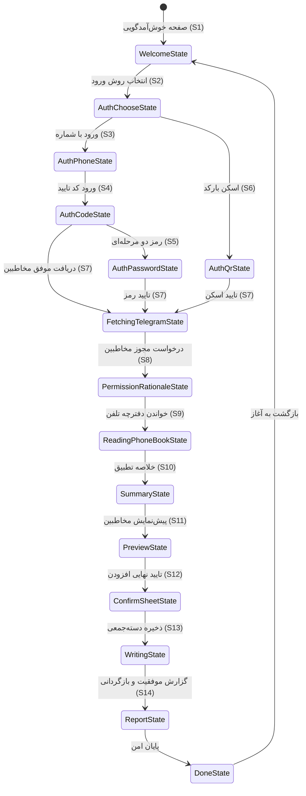

# تلسینک (TelSync) — کتابچه راهنمای جامع معماری، فنی و عملیاتی

> **نام برند:** تلسینک (TelSync)  
> **شعار:** انتقال امن و مستقیم مخاطبین تلگرام به گوشی  
> **نسخه مستند:** ۲.۰  
> **تاریخ به‌روزرسانی:** نوامبر ۲۰۲۶  
> **مخاطبان هدف:** دستیارهای هوش مصنوعی (Antigravity، Gemini، Claude، GPT)، مشارکت‌کنندگان اصلی و نگهدارندگان فنی سیستم.

---

## ۱. خلاصه اجرایی و رسالت اصلی

**تلسینک (TelSync)** (پیش‌تر با نام Contact Bridge) یک اپلیکیشن موبایل آفلاین‌محور و بدون سرور (Zero-Backend) است که با **Flutter و Dart** ساخته شده است. این نرم‌افزار به کاربران اجازه می‌دهد مخاطبین اکانت **تلگرام (Telegram)** خود را مستقیماً و با بالاترین سطح امنیت به دفترچه تلفن فیزیکی گوشی استخراج و همگام‌سازی نمایند.

### ۱.۱. مشکلی که حل می‌شود
میلیون‌ها کاربر صدها شماره تلفن مهم دارند که صرفاً در چت‌ها و مخاطبین متقابل تلگرام ذخیره شده‌اند و در دفترچه تلفن گوشی ثبت نیستند (مثلاً پس از تعویض گوشی، سوختن سیم‌کارت، یا ذخیره کردن فرد صرفاً در چت تلگرام).

### ۱.۲. ۱۱ اصل تغییرناپذیر معماری (قانون اساسی نرم‌افزار)
تمامی دستیارهای هوش مصنوعی و توسعه‌دهندگان **باید بدون هیچ‌گونه استثنا** این ۱۱ اصل را رعایت کنند:

1. **اصل اول (INV-01 - پردازش ۱۰۰٪ محلی):** کلیه مراحل نرمال‌سازی شماره‌ها، تطبیق، پردازش، تحلیل و نوشتن در حافظه دستگاه منحصراً روی گوشی فیزیکی کاربر انجام می‌گیرد.
2. **اصل دوم (INV-02 - عدم وجود هرگونه بک‌اند سازنده):** توسعه‌دهنده برنامه هیچ‌گونه سرور، پایگاه داده یا اندپوینتی برای این اپلیکیشن ندارد. هیچ شماره، نام، کلید نشست یا لاگی از گوشی به هیچ سرور متفرقه‌ای ارسال نمی‌شود.
3. **اصل سوم (INV-03 - بدون حساب کاربری داخلی):** این نرم‌افزار نیازی به ثبت‌نام، ورود با ایمیل یا ساخت پروفایل کاربری اختصاصی ندارد.
4. **اصل چهارم (INV-04 - تضمین دست‌نخوردن مخاطبین فعلی):** مخاطبین موجود در دفترچه تلفن کاربر **هرگز** ویرایش، ادغام، جابه‌جا یا حذف نمی‌شوند.
5. **اصل چهارم-الف (INV-04a - قابلیت بازگردانی موقت Undo):** قابلیت بازگردانی (Undo) صرفاً شناسه‌هایی را که در *همان نوبت فعال فعلی* روی حافظه موقت (RAM) ثبت شده‌اند حذف می‌کند. پس از بسته شدن برنامه، هیچ خطری مخاطبین را تهدید نخواهد کرد.
6. **اصل پنجم (INV-05 - فقط افزایشی Additive-Only):** تنها شماره‌های معتبر تلگرامی که در گوشی موجود نیستند، به عنوان مخاطب جدید ذخیره می‌شوند.
7. **اصل ششم (INV-06 - پیش‌نمایش شفاف و رضایت کاربر):** کاربر **باید** لیست تفکیک‌شده و کامل نام‌ها و شماره‌ها را مشاهده کرده و امکان انتخاب/لغو انتخاب و ویرایش نام داشته باشد؛ پیش از آن هیچ چیزی در دیسک ذخیره نمی‌شود.
8. **اصل هفتم (INV-07 - رایگان بودن هسته اصلی):** کارکرد پایه استخراج و سینک مخاطبین کاملاً در دسترس و بدون مسدودی مالی است.
9. **اصل هشتم (INV-08 - ایزوله‌سازی ماژول تبلیغات):** ماژول‌های تبلیغاتی احتمالی در آینده (تپسل، یکتانت و...) باید کاملاً در لایه ایزوله (`packages/ads_noop`) اجرا شوند و هیچ دسترسی‌ای به مجوزها یا داده‌های مخاطبین نداشته باشند.
10. **اصل نهم (INV-09 - ممنوعیت کتابخانه‌های ردیابی و آمارگیر):** استفاده از Firebase Analytics، Crashlytics یا هر SDK ردیابی که وضعیت سیستم را بخواند ممنوع است.
11. **اصل دهم (INV-10 - لیست سفید سخت‌گیرانه متدهای تلگرام):** ارتباط با تلگرام فقط و فقط از طریق یک لیست سفید بررسی‌شده از متدهای TDLib C++ امکان‌پذیر است.
12. **اصل یازدهم (INV-11 - پاکسازی کامل نشست و خروج سروری):** نشست تلگرام کاملاً موقت (Ephemeral) است. به محض اتمام کار، انصراف یا بستن اپلیکیشن، دستور رسمی `logOut` به تلگرام فرستاده شده و دیتابیس محلی پاکسازی می‌شود تا هیچ نشستی در بخش «دستگاه‌های فعال» کاربر باقی نماند.

---

## ۲. استک فناوری و مشخصات محیط

| مؤلفه | فناوری / کتابخانه | نسخه / توضیحات |
| :--- | :--- | :--- |
| **فریم‌ورک** | Flutter | `>=3.0.0 <4.0.0` (Dart 3 همراه با sealed classes و pattern matching) |
| **مدیریت وضعیت** | `flutter_riverpod` | `^3.4.3` بر پایه معماری (`Notifier<FlowState>`) |
| **هسته تلگرام** | **TDLib (Telegram Database Library)** | کتابخانه اشتراکی C++ با نام `libtdjson.so` از طریق Dart FFI |
| **پل هم‌زمانی** | Background Dart Isolate | اجرای حلقه مستقل ۲۰ میلی‌ثانیه‌ای در پس‌زمینه برای خواندن پیام‌های TDLib بدون کندی UI |
| **ارتباط بومی با اندروید** | Flutter Pigeon | تولید کدهای Type-safe برای دسترسی مستقیم به `ContactsContract` |
| **موتور نرمال‌سازی شماره** | Pure Dart Phone Engine | استخراج قالب E.164، تبدیل ارقام فارسی و عربی (`۰-۹` به `0-9`) |
| **سیستم طراحی رابط کاربری** | Material 3 + Custom Tokens | کنتراست بالا، چیدمان کامل راست‌چین (RTL)، فونت فارسی وزیرمتن (Vazirmatn) |
| **بین‌المللی‌سازی (l10n)** | `packages/l10n` | پشتیبانی دو زبانه کامل انگلیسی (`en`) و فارسی (`fa`) |
| **بهینه‌سازی حجم خروجی** | R8/ProGuard + ABI Splits | فایل خروجی APK برای معماری `arm64-v8a`: **حدود ۴۹ مگابایت** |

---

## ۳. معماری مونو‌ریپو (Monorepo) و تفکیک وظایف پکیج‌ها

پروژه به صورت ماژولار و پکیج‌بندی‌شده طراحی شده است تا منطق تجاری کاملاً مستقل از لایه‌های بصری فلاتر باشد:

```
tel/
├── apps/
│   └── mobile/                       # اپلیکیشن اصلی فلاتر
│       ├── android/                  # تنظیمات بومی اندروید، jniLibs و قوانین ProGuard
│       ├── lib/
│       │   ├── config/               # تنظیمات تلگرام (AppConfig) و مشخصات محیط
│       │   ├── controllers/          # کنترلر Riverpod (ImportFlowController)
│       │   ├── services/             # سرویس موقعیت‌یابی شبکه و تشخیص وضعیت اینترنت/VPN
│       │   ├── views/                # نماهای S1 تا S18 و پاپ‌آپ‌ها
│       │   └── main.dart             # نقطه شروع برنامه
│       └── test/                     # آزمون‌های کنترلر، تست ویجت و چرخه حیات
├── packages/
│   ├── core_domain/                  # بدون وابستگی به فلاتر: ماشین وضعیت، رویدادها، انتزاع‌ها
│   ├── core_phone/                   # بدون وابستگی به فلاتر: نرمال‌سازی شماره و E.164
│   ├── match_engine/                 # بدون وابستگی به فلاتر: الگوریتم تطبیق و روابط آماری
│   ├── source_telegram/              # Dart FFI: کلاینت C، پل Isolate، لیست سفید متدها
│   ├── sink_phonebook/               # تعامل Pigeon با دفترچه تلفن بومی دستگاه
│   ├── platform_security/            # پاکسازی نشست و تولید کلید رمزنگاری محلی
│   ├── design_system/                # توکن‌ها، AppScaffold، OtpField، TrustCard
│   ├── l10n/                         # رشته‌های متنی دو زبانه (فارسی و انگلیسی)
│   └── ads_noop/                     # لایه انتزاعی خالی برای ایزوله‌سازی تبلیغات
├── tools/                            # اسکریپت‌های سیستمی و اعتبارسنجی
│   ├── run_env.ps1                   # تنظیم خودکار متغیرهای محیطی جاوا ۱۷ و Android SDK
│   ├── run_all_tests.ps1             # اجرای آزمون‌های یکپارچه کل مونو‌ریپو
│   ├── check_allowlist.dart          # بررسی لیست سفید متدهای مجاز TDLib
│   └── check_deps.dart               # اعتبارسنجی وابستگی‌ها برای جلوگیری از بسته‌های غیرمجاز
└── docs/                             # مستندات فنی و راهنماهای انتشار
```

---

## ۴. ماشین وضعیت (State Machine) و نگاشت صفحات (S1 تا S18)

جریان برنامه بر مبنای یک ماشین وضعیت قطعی عمل می‌کند که توسط `FlowReducer` هدایت می‌شود:



### جدول نگاشت کامل صفحات و وضعیت‌ها:

| کد صفحه | نام کلاس ویجت | کلاس وضعیت (State) | شرح کارکرد و مسئولیت‌ها |
| :--- | :--- | :--- | :--- |
| **S1** | `S1WelcomeView` | `WelcomeState` | صفحه ورودی اصلی؛ نمایش کارت‌های امنیت، تغییر زبان و بررسی فیلترشکن پیش از ورود. |
| **S2** | `S2AuthChooseView` | `AuthChooseState` | انتخاب شیوه ورود: شماره موبایل (پیشنهادی برای همین گوشی) در مقابل اسکن QR با دستگاه دیگر. |
| **S3** | `S3AuthPhoneView` | `AuthPhoneState` | ورود شماره موبایل؛ کادر مدرن با انتخاب پویای کشورها، نرمال‌سازی ارقام و مدیریت خطاهای تلگرام. |
| **S4** | `S4AuthCodeView` | `AuthCodeState` | فیلد کد تایید ۵ رقمی امن همراه با قابلیت ارسال خودکار با تکمیل رقم پنجم. |
| **S5** | `S5AuthPasswordView` | `AuthPasswordState`| **رمز عبور ابری دو مرحله‌ای (2FA):** دریافت راهنمای رمز (Hint) از تلگرام و اعتبارسنجی رمز عبور. |
| **S6** | `S6AuthQrView` | `AuthQrState` | نمایش کد QR پویا با زمان انقضا برای اسکن با تلگرام کامپیوتر یا گوشی دوم. |
| **S7** | `S7FetchingView` | `FetchingTelegramState`| نوار پیشرفت دریافت امن لیست مخاطبین از فضای ابری تلگرام. |
| **S8** | `S8PermissionView` | `PermissionRationaleState`| توضیح شفاف درباره علت نیاز به دسترسی دفترچه تلفن پیش از باز شدن کادر سیستمی اندروید. |
| **S9** | `S9AnalyzingView` | `ReadingPhoneBookState` / `AnalyzingState` | مقایسه و تطبیق ۱۰۰٪ محلی شماره‌ها روی پردازنده گوشی. |
| **S10** | `S10SummaryView` | `SummaryState` | نمایش آمار کارت‌ها (جدید، تکراری، نیازمند بررسی). **در صورت همگام‌بودن کامل، پاپ‌آپ و دکمه‌های خروج/شروع جدید باز می‌شود.** |
| **S11** | `S11PreviewView` | `PreviewState` | لیست تعاملی و دسته‌بندی‌شده کاندیداها، تغییر نام و تیک زدن موارد دلخواه. |
| **S12** | `S12ConfirmSheet` | `ConfirmSheetState` | برگه مودال پایینی برای آخرین تایید قطعی کاربر قبل از عملیات نوشتن روی دیسک. |
| **S13** | `S13WritingView` | `WritingState` | پیشرفت‌نمای افزودن دسته‌جمعی شماره‌ها به `ContactsContract` دستگاه. |
| **S14** | `S14ReportView` | `ReportState` | نمایش آمار قطعی افزوده شده همراه با دکمه **بازگردانی آنی (Undo)** در صورت انصراف کاربر. |
| **S15** | `S15SettingsSheet` | *پاپ‌آپ تنظیمات* | تغییر تم، سوئیچ زبان بین فارسی و انگلیسی، مدیریت نشست. |
| **S16** | `S16AboutSheet` | *پاپ‌آپ درباره* | بیانیه شفافیت، اصول حریم خصوصی و استانداردهای طراحی بدون سرور. |
| **S17** | `S17RecoveryView` | `RecoveryCleanupState` / `CleanupState` | بازیابی ایمن و پاکسازی کامل نشست پس از هرگونه خطای ارتباطی یا لغو توسط کاربر. |
| **S18** | `S18ErrorView` | *پیام‌های خطا / SnackBar* | اعلام شفاف خطاهای شبکه، محدودیت تلاش تلگرام (Flood Wait) یا خطای تایم‌اوت. |

---

## ۵. هسته تعامل با تلگرام (TDLib و پکیج Source Telegram)

### ۵.۱. معماری ارتباطی TDLib
برنامه دارای باینری‌های کامپایل‌شده C++ با نام `libtdjson.so` برای معماری‌های `arm64-v8a`، `armeabi-v7a` و `x86_64` است.

```
لایه رابط کاربری (UI Isolate)
     │
     ▼ (فراخوانی از کنترلر فلاتر)
ImportFlowController
     │
     ▼ (مدیریت چرخه نشست)
TdlibAuthSession
     │
     ▼ (تبادل دوسویه SendPort / ReceivePort)
TelegramIsolateBridge (ایزولیت مستقل در بک‌گراند)
     │
     ▼ (Dart FFI)
TdJsonClient (libtdjson.so)
     │
     ▼ (پروتکل امن MTProto بر بستر TCP)
سرورهای رسمی تلگرام
```

### ۵.۲. لیست سفید سخت‌گیرانه متدها (INV-10)
تنها متدهای زیر در فایل `packages/source_telegram/lib/td_request_factory.dart` مجاز هستند:
```dart
const allowableMethods = <String>{
  'setTdlibParameters',
  'checkDatabaseEncryptionKey',
  'setAuthenticationPhoneNumber',
  'checkAuthenticationCode',
  'checkAuthenticationPassword', // پشتیبانی از رمز دو مرحله‌ای 2FA
  'requestQrCodeAuthentication',
  'getContacts',
  'getUser',
  'logOut',
  'close',
  'destroy',
};
```
هرگونه تلاش برای صدا زدن متدهای خواندن چت‌ها، کانال‌ها یا پیام‌ها خطای زمان کامپایل و شکست آزمون‌های خودکار ایجاد خواهد کرد.

### ۵.۳. احراز هویت دو مرحله‌ای (2FA)
1. چنانچه اکانت کاربر دارای رمز عبور ابری باشد، تلگرام وضعیت `authorizationStateWaitPassword` را صادر می‌کند.
2. کنترلر با استخراج متن راهنما (Hint)، صفحه `S5AuthPasswordView` را باز می‌کند.
3. کاربر رمز عبور خود را وارد کرده و در صورت صحیح بودن فوراً به مرحله استخراج مخاطبین هدایت می‌شود؛ در صورت اشتباه بودن رمز، پیام متناسب به کاربر ارائه می‌شود.

### ۵.۴. خروج خودکار و پاکسازی نشست (INV-11)
- به محض خروج از صفحه گزارش یا فشردن دکمه خروج اضطراری، دستور رسمی `logOut` تلگرام صادر می‌گردد.
- پوشه فایل‌های محلی SQLite دیتابیس موقت برنامه حذف می‌شود تا هیچ ردی در بخش «Active Sessions» تلگرام باقی نماند.

---

## ۶. گارد شبکه و فیلترینگ (`VpnGuardianDialog`)

به علت فیلتر بودن تلگرام در ایران، اتصال بدون پروکسی یا فیلترشکن موجب خطای تایم‌اوت و مسدودی موقت می‌شود.

### نحوه عملکرد سیستم تشخیص:
- **سرویس تشخیص موقعیت:** کلاس `NetworkLocationService` با استفاده از `dart:io` و بدون نیاز به بسته‌های سنگین خارجی، موقعیت کاربر را استعلام می‌کند.
- **رفتار هوشمند:** در صورت تشخیص آی‌پی ایران (`IR`)، پنجره راهنمای انیمیشنی فعال می‌گردد.
- **بررسی مداوم:** هر ۲۰ ثانیه یک‌بار موقعیت کاربر بررسی می‌شود و دکمه «بررسی مجدد» نیز در دسترس است؛ به محض روشن شدن فیلترشکن و تغییر آی‌پی، پنجره سبز شده و خودکار بسته می‌شود تا کاربر بتواند بدون دغدغه فرآیند را تکمیل کند.

---

## ۷. راهنمای کامپایل و عملیات فنی توسعه‌دهندگان

### ۷.۱. اجرای ایمن محیط
به دلیل نیاز به جاوا ۱۷ و تنظیمات محیطی فلاتر، دستورات از طریق اسکریپت رانر اجرا شوند:
```powershell
powershell -ExecutionPolicy Bypass -File tools/run_env.ps1 "cd apps/mobile; flutter analyze; flutter test"
```

### ۷.۲. کامپایل بهینه فایل نصبی APK برای انتشار
از دستور خام `flutter build apk` به تنهایی استفاده **نکنید**؛ حتماً فلگ جداسازی بر اساس معماری پردازنده را قرار دهید:
```powershell
powershell -ExecutionPolicy Bypass -File tools/run_env.ps1 "cd apps/mobile; flutter build apk --release --split-per-abi"
```
**فایل‌های خروجی در مسیر `apps/mobile/build/app/outputs/flutter-apk/`:**
- `app-arm64-v8a-release.apk` (حدود ۴۹ مگابایت) — خروجی اصلی مناسب ۹۹٪ گوشی‌های مدرن بازار.
- `app-armeabi-v7a-release.apk` (حدود ۳۶ مگابایت) — مناسب گوشی‌های قدیمی ۳۲ بیتی.

---

## ۸. قوانین طلایی برای دستیارهای هوش مصنوعی آینده

1. **هرگز از داده‌های ساختگی (Mock) در محیط واقعی استفاده نکنید:** کلیه فرآیندهای ارتباط با تلگرام باید از لایه TDLib بگذرد مگر در آزمون‌های یونیت ویجت.
2. **اصل INV-04 را هرگز نقض نکنید:** هیچ کدی حق ویرایش، جایگزینی یا حذف مخاطبین قبلی گوشی را ندارد.
3. **پشتیبانی دو زبانه را حفظ کنید:** برای هر رشته متنی جدید، متناظر فارسی و انگلیسی را در `packages/l10n/lib/l10n.dart` ثبت نمایید.
4. **حجم خروجی را کنترل کنید:** قوانین ProGuard در مسیر `apps/mobile/android/app/proguard-rules.pro` را حفظ نمایید.
5. **پیش از ثبت هر کامیت، تست‌ها را اجرا کنید:**
```powershell
powershell -ExecutionPolicy Bypass -File tools/run_all_tests.ps1
```
